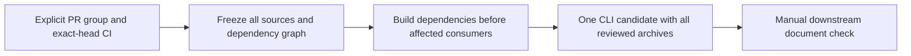

# Dependency candidate preparation

GitHub prepares one immutable temporary CLI PR per selected wave of Dependabot updates.
It does not access private CI/review APIs, hold internal OAuth credentials, send
notifications, observe document checks, merge PRs or publish npm packages.

## Supported repositories and waves

`DEPENDENCY_TRAIN_REPOSITORIES=all` inventories registered packages under
`packages/` and `extensions/` using the explicit build model in
`scripts/candidate-train/model.js`. The current metapackage has 25 registered
packages/extensions: **23 are supported; direct CLI and VSC updates remain
excluded**. This is not every organization repository or every npm dependency.
Infrastructure-only repositories require their own verification paths.
An explicit comma-separated allowlist remains valid without the old
three-repository limit.

The model includes ordinary runtime dependencies, client asset build inputs,
and six packages bundled or copied during CLI build: latex, mermaid, openapi,
page-constructor, search and yfmlint. It does not treat every development tool
as a shipped dependency. The model also declares four opt-in integration roots:
algolia, folding-headings, html and quote-link. Only selected opt-ins add virtual
CLI edges and exact candidate-only archive dependencies; other waves do not
silently acquire these extensions. Canonical source manifests remain unchanged.

Only **low policy-risk** patch/minor updates qualify. This is output-impact risk,
not CVSS; a patch or minor is not automatically low risk. Other risks and
major/new/removed/ignored changes need separate review. Current master bases,
green exact-head required checks and publisher bindings remain mandatory.

All eligible PRs are ordered by creation time, repository and PR number. Waves
contain at most three PRs and at most one PR per repository. `train-plan.json`
records the complete eligible/excluded inventory; the summary limits long lists
to 100 waves/exclusions and points to that artifact. More than 2,000 considered
PRs is an explicit error, not a silently partial inventory.

## Trust boundary

1. Select dependency-only, low-risk patch/minor updates with green exact-head
   required checks and explicit publisher bindings. New/removed dependencies,
   major updates, unknown evidence and ignored changes fail closed.
2. Freeze infrastructure, metapackage, CLI base and source SHAs. Rebuild affected
   consumers, including client assets for component changes.
3. Build/pack without secrets. Relocatable archives and scoped overrides carry
   source lock versions. Verify installed identities, run CLI tests/typecheck and
   HTML/Markdown smoke builds. Do not update baselines.
   Resolution proof paths describe runtime dependency chains, not physical
   lockfile directories. Resolve each edge from its installed parent and require
   its exact source-lock version, including source-owned peers and cycle-closing
   edges. External peers use a compatible frozen CLI provider with its exact tree. Optional branches may be absent; present versions must still match.
   Independently compare logical dependency chains with the frozen CLI lock,
   including CLI tooling dependencies. Unselected consumer package versions and
   registry identities, dependency edges and resolutions may not drift merely
   because an archive was rebuilt. Hoisting alone is not a version change.
   Only selected, model-declared opt-in roots may add an exact archive dependency;
   their subtrees must still match canonical source locks.
   Incompatible or ambiguous source locks require an explicit baseline refresh;
   never replace versions while claiming the original schema 1 source-lock proof.
4. On a fresh publisher, independently validate the dependency delta and data against canonical source
   locks. Use the existing CLI-scoped App token and contributor bot credential to
   open one immutable CLI candidate. Never execute candidate code in this job.
5. Stop at **prepared, not verified**. The existing internal webhook prepares its
   Internal check. Hand off the CLI PR number, full head SHA and infrastructure
   tooling SHA to the separately reviewed internal operations observer.

## Opt-in activation coverage

An installed archive is not proof that its feature ran. Preparation builds
separate temporary HTML and Markdown configurations for each selected opt-in.
All selected archives remain installed in the same candidate CLI. Checks require
folding sections, quote-link blocks, sandboxed HTML
iframes, or Algolia provider/local search artifacts as appropriate. Runtime
assets must be attached and match bytes from the installed candidate package.
Algolia smoke does not upload an index: inherited Algolia settings are cleared,
index upload is disabled and the CLI subprocess has a network guard.

Successful fixture checks are recorded separately in `proof.integrations` with
scope `generated-fixture`. The publisher requires the exact selected coverage.
The schema 1 `resolutions` field retains its runtime-chain meaning. Fixtures,
adapters and temporary host links are not published into the CLI source tree.

These checks do not force opt-ins into arbitrary internal documents. That corpus
uses its own configuration; a green generated fixture does not certify a feature
inside every internal document. A full manual downstream pilot remains required
for the expanded build model before relying on its Internal Check handoff.

Published-package probes on 2026-10-28 passed Algolia 0.7.2, folding-headings
0.2.5 and quote-link 0.1.8 against CLI 5.64.0. HTML 2.9.14 fails its default
srcdoc scenario because the CLI's outer sanitizer removes iframe content. The
train retains this failure; it does not disable sanitization to obtain success.
Package support means a runnable check, not a guarantee of a passing baseline.

Independent fixtures do not certify same-page composition. A separate published
folding-headings + quote-link probe found a shared runtime-copy cache key that
drops quote-link assets. Neither existing package integration defect is repaired
by the infrastructure build model.

Internal observation belongs to Viewer operations. Internal API credentials,
endpoints, review links, CA configuration and notification credentials stay
inside the internal infrastructure and its existing secret/notification system.
They must not be configured in GitHub Actions. The observer reads frozen public
candidate data, independently checks installed-version proof and exact document
results, and reports through the existing internal notification transport.
Missing proof, skipped checks or a stale SHA/diff cannot count as success.

## Manual waves without enabling a schedule

Dispatch `dependency-candidate-train.yml` with:

- `repositories: all` (or empty to use the organization variable);
- `pr_number: 0` for automatic selection;
- `wave: 1`;
- `dry_run: true` for selection only, the default.

After inspecting that exact selection, `dry_run: false` explicitly approves
one preparation of the selected wave. This does not require changing an organization variable.
With one explicitly named repository, `pr_number` can select an exact open
Dependabot PR. An open temporary CLI candidate is reported before heavy build
and prevents another preparation, without closing or certifying the existing PR.
The publisher repeats the final race check before creating a new candidate.
Selection/build jobs have no secrets. Publication uses only existing GitHub
credentials (`INFRA_APP_ID`, `INFRA_APP_PRIVATE_KEY`, `INFRA_APPROVER_PAT`).
The public summary and `train-candidate.json` contain only public identities;
they never claim successful Internal verification.

Start the internal observer manually after preparation, using the three frozen
handoff values. The operator still presses the document CI button when notified.
Nothing merges the candidate or source PR. Close the temporary CLI PR without
merge after inspecting the result; a still-needed timed-out candidate may remain
open for an explicitly resumed observation. A new train has a new immutable plan.

Each wave is an **independent candidate**, not cumulative validation of earlier
waves. `wave: 2` tests only that wave. After verification, separately merge
approved source PRs, refresh remaining Dependabot bases/CI and run a new dry-run.
Typically continue with wave 1 of the new inventory: wave numbers can change
after merges or source-head updates. Nothing automatically advances or merges.

For example, rebuilding translation for a tabs update must not silently carry
`js-yaml@4.1.1` or downgrade unrelated dependencies. A mismatch with the frozen
CLI baseline blocks preparation; this change does not repair source lockfiles
or hide existing baseline vulnerabilities. Dependency review remains required.

## Manual coordinated groups

For an explicit group, dispatch `dependency-candidate-train.yml` with
`cohort_prs` as comma-separated `repo#PR` identities and `dry_run: true`.
One PR per supported registered repository is allowed, up to the graph limit
of 40. Keep `pr_number: 0` and `wave: 1`; independent waves do not apply.
The explicit list supplies the repository scope without changing organization
variables. Sources may be human-authored or Dependabot PRs, but must be open,
same-repository, dependency-only, low-risk patch/minor updates with green checks
on their exact heads and current master bases. A failure rejects the whole
group instead of silently dropping a member. No source branches are merged.

Set `cohort_dependency` when updating one dependency across packages. Every
registered direct consumer must be present, except the existing direct CLI/VSC
exclusions, and every canonical source lock must resolve one exact stable
version. An existing direct override may follow only that same dependency's
manifest requirement. Unrelated override or source changes remain forbidden.
VSC still requires its separate standalone checks; a CLI candidate does not
certify the editor extension.

After inspecting the group, repeat the same inputs with `dry_run: false`.
The publisher independently re-derives the group, graph, source manifests,
policy and exact-head CI against the dispatch inputs. A changed member or
baseline requires a new plan. The build checks the common dependency and its
canonical transitive tree even when it is a dev-only build input.
This checks selected package builds; it does not overwrite the frozen CLI
host/tooling dependency tree.

The existing graph includes runtime/optional edges, client asset build inputs,
CLI-bundled inputs and selected opt-in integrations. Every affected consumer is
rebuilt in dependency order; cycles in the affected build graph and missing
graph paths reject preparation.
This is one combined candidate, not several independent green waves.

Manual groups use **plan schema 2**. This is independent of installed peer-proof
schemas 1/2, whose version and integrity checks remain unchanged. Merge the
compatible downstream consumer before relying on this producer mode. Older
consumers reject these plans. Scheduled selection retains schema 1 and its
three-PR wave limit; this feature changes no schedule, distribution or merge gate.

## Scheduled preparation controls

`DEPENDENCY_CANDIDATE_TRAIN_ENABLED` absent/false disables scheduled preparation.
The retained cron is 06:17 Europe/Moscow, targeting readiness by 08:00;
GitHub scheduling is not an SLA. `DEPENDENCY_TRAIN_REPOSITORIES` is an explicit
repository allowlist or `all`. Scheduled preparation selects wave 1; other waves
are explicitly selected on manual dispatch. No new organization variable is
needed. Repository variables in infra override organization
values; variables in source repositories do not control this central workflow.

Do not enable scheduled preparation before the internal handoff and one full
manual pilot have passed. This change does not enable it. Internal observation
also has no schedule. Health audits, distribution and auto-merge are independent
gates and remain unchanged. Turning off a schedule flag does not cancel already
running jobs or an existing Internal check.

The 08:00 readiness timestamp is metadata, not a deadline guarantee. This change
does not alter the cron, add an external dispatcher, or enable any automation.

## Preserving the CLI installation

Intermediate source builds retain scoped canonical runtime overrides and their
existing installation procedure. The exact cohort dependency and its complete
source-lock tree are verified before and after each selected package build.

The final CLI build constructs a scratch candidate lock from the frozen CLI lock and the
canonical archive locks. Unrelated CLI package identities are retained; archive
runtime dependencies get private contexts where needed. No free `npm install`
resolution is used for the CLI. The candidate is checked independently against
both baselines, installed with `npm ci`, and the actual unchanged CLI trees are
checked before and after its build/tests. Source lockfiles and proof digests are
never rewritten. Proof schema 3 distinguishes ordinary source-owned dependencies
from external peers: ordinary trees stay canonical, while an external peer uses
a range-compatible provider from the frozen CLI, including its exact identity
and complete tree. An ambiguous, missing or incompatible provider fails closed.
A new selected opt-in may use an existing CLI root provider, never a new provider.

Schema 3 separately records `builds` receipts for every packed package, including
packages used only to build client assets. Receipts bind source and lock hashes,
archive bytes, direct rebuilt inputs and the exact cohort build dependency.
`packages` covers only archives actually installed in CLI runtime. A components
build receipt is not evidence that components is installed in CLI.

The downstream schema-3 consumer installs the unchanged public candidate lock
with `npm ci` in an isolated CLI package rather than a builder workspace. It
independently derives the graph, verifies actual installed identities and checks
them again before packaging. Deploy that consumer before relying on schema-3
Internal Check; older consumers reject the new evidence. Legacy proof schemas
1 and 2 retain their original validation.

## Legacy optional host peers

An optional peer at the archive root or in a required runtime dependency, missing
from its canonical source lock, may use an existing CLI provider only when its
peer declaration is unchanged from the frozen
CLI baseline. Every original archive context must resolve the same exact provider
identity and dependency tree. New providers, declaration changes and ambiguous
contexts require a separately reviewed baseline update. Ordinary optional and
required dependencies retain their canonical-lock checks.

Such payloads use proof schema 2: `hostPeers` records each package, canonical owner
context and peer name; `cliBaseLockSha256` binds the frozen CLI lock. The publisher independently derives
both from immutable source locks and rejects missing, extra or downgraded evidence.
The build checks the actual installed providers too. Payloads without host peers
retain schema 1. Deploy the downstream schema-2 verifier before merging producer
support; an older consumer rejects schema 2 rather than silently ignoring it.
