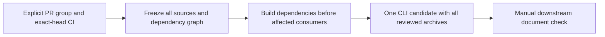

# Dependency candidate preparation

GitHub prepares one immutable temporary CLI PR per selected coordinated group or legacy wave of Dependabot updates.
It does not access private CI/review APIs, hold internal OAuth credentials, send
notifications, read private document checks or publish npm packages. The separate manual merge
workflow consumes a public exact-train verdict from the trusted verifier App.

## Supported repositories and waves

`DEPENDENCY_TRAIN_REPOSITORIES=all` inventories registered packages under
`packages/` and `extensions/` using the explicit build model in
`scripts/candidate-train/model.js`. The current metapackage has 25 registered
packages/extensions: **23 are supported; direct CLI and VSC updates remain
excluded**. This is not every organization repository or every npm dependency.
Infrastructure-only repositories require their own verification paths.
An explicit comma-separated allowlist remains valid without the old
three-repository limit.

The model includes ordinary runtime dependencies, client asset build inputs,
and six packages bundled or copied during CLI build: latex, mermaid, openapi,
page-constructor, search and yfmlint. It does not treat every development tool
as a shipped dependency. The model also declares four opt-in integration roots:
algolia, folding-headings, html and quote-link. Only selected opt-ins add virtual
CLI edges and exact candidate-only archive dependencies; other waves do not
silently acquire these extensions. Canonical source manifests remain unchanged.

Only patch/minor updates qualify. Policy risk measures possible impact on
Diplodoc output and tooling. Major/new/removed/ignored changes need separate
review. Current master bases and green required checks on the exact PR head
are mandatory. When the repository requires a specific App for a check, the
train enforces that binding. A rule set to Any source is also eligible.

| Coordinated selection                                                      | Result                                                                                                            |
| -------------------------------------------------------------------------- | ----------------------------------------------------------------------------------------------------------------- |
| `risk_level: auto` with the organization ceiling unset or `low`            | Checks only low-risk groups.                                                                                      |
| `risk_level: auto` with `DEPENDENCY_TRAIN_MAX_RISK=medium\|high\|critical` | Tries complete groups in ascending risk order up to the ceiling.                                                  |
| Manual `risk_level: low\|medium\|high\|critical`                           | Selects groups whose maximum source risk equals the chosen level. Lower-risk PRs of the same group stay included. |

Only use the higher levels after deploying the compatible internal builder.
The same ceiling also limits the [separate manual merge](#separate-manual-merge-after-verification).

The default selector groups eligible Dependabot PRs by one changed direct dependency
and its exact stable locked version. Every registered direct consumer must either have
one eligible PR for that version, or already lock it at the frozen current master SHA.
Missing, unhealthy, conflicting or ambiguous consumers block the whole group. Narrow
repository allowlists cannot silently reduce coverage. Already-updated consumers are
recorded in `cohort.baseline` and independently revalidated from canonical locks.
Groups are ordered by maximum source risk, oldest PR, then dependency identity.
`wave` sets the starting group index. Morning can try up to three complete
automatic groups in order. Each attempt runs on a separate runner. Only a
dependency resolution mismatch permits the next attempt. Failed builds and
tests stop the run, as does a mismatch on the last available attempt. Morning
publishes at most one CLI PR, for the first successful attempt, after the
publisher independently rechecks that group's exact sources and payload.
Explicit cohorts and legacy waves still prepare one candidate.

A lock-only update can join an automatic group when it changes the resolved
version of a dependency declared directly in `package.json`. A transitive-only
update has no such direct input to identify the group and its consumers.

Explicit `selection_mode: wave` preserves the legacy low-risk-only independent selector: eligible
PRs are ordered by creation time, repository and PR number, with at most three PRs
and one PR per repository. `train-plan.json`
records the complete eligible/excluded inventory; the summary limits long lists
to 100 waves/exclusions and points to that artifact. More than 2,000 considered
PRs is an explicit error, not a silently partial inventory.

## Trust boundary

1. Select dependency-only patch/minor updates with green exact-head required
   checks from the publishers allowed by the repository rules. For elevated risks
   that require deep verification, require the successful Testpack comparison and
   its exact profile artifact from the same run attempt. New/removed dependencies, major updates,
   unknown evidence and ignored changes fail closed.
2. Freeze infrastructure, metapackage, CLI base and source SHAs. Rebuild affected
   consumers, including client assets for component changes.
3. Build/pack without secrets. Relocatable archives and scoped overrides carry
   source lock versions. Verify the installed CLI archives against their canonical
   locks immediately after installation and again after CLI tests. A mismatch reports
   the source and the expected and installed versions before running CLI build and tests.
   Run CLI typecheck and HTML/Markdown smoke builds. Do not update baselines.
   Resolution proof paths describe runtime dependency chains, not physical
   lockfile directories. Resolve each edge from its installed parent and require
   its exact source-lock version, including source-owned peers and cycle-closing
   edges. External peers use a compatible frozen CLI provider with its exact tree. Optional branches may be absent; present versions must still match.
   Independently compare logical dependency chains with the frozen CLI lock,
   including CLI tooling dependencies. Unselected consumer package versions and
   registry identities, dependency edges and resolutions may not drift merely
   because an archive was rebuilt. Hoisting alone is not a version change.
   Only selected, model-declared opt-in roots may add an exact archive dependency;
   their subtrees must still match canonical source locks.
   Incompatible or ambiguous source locks require an explicit baseline refresh;
   never replace versions while claiming the original schema 1 source-lock proof.
4. On a fresh publisher, independently validate the dependency delta and data against canonical source
   locks. Use the existing CLI-scoped App token and contributor bot credential to
   open one immutable CLI candidate. Never execute candidate code in this job.
5. Stop at **prepared, not verified**. With the private candidate rollout flag enabled,
   the existing Viewer handler starts the exact-head candidate pipeline and retains
   its callback identity. Prerelease document CI starts automatically. The public
   exact-train verdict requires a successful document badge on the stable active diff
   and verified installed trees. Ordinary Internal Check routing is unchanged.

## Opt-in activation coverage

An installed archive is not proof that its feature ran. Preparation builds
separate temporary HTML and Markdown configurations for each selected opt-in.
All selected archives remain installed in the same candidate CLI. Checks require
folding sections, quote-link blocks, sandboxed HTML
iframes, or Algolia provider/local search artifacts as appropriate. Runtime
assets must be attached and match bytes from the installed candidate package.
Algolia smoke does not upload an index: inherited Algolia settings are cleared,
index upload is disabled and the CLI subprocess has a network guard.

Successful fixture checks are recorded separately in `proof.integrations` with
scope `generated-fixture`. The publisher requires the exact selected coverage.
The schema 1 `resolutions` field retains its runtime-chain meaning. Fixtures,
adapters and temporary host links are not published into the CLI source tree.

These checks do not force opt-ins into arbitrary internal documents. That corpus
uses its own configuration; a green generated fixture does not certify a feature
inside every internal document. A full manual downstream pilot remains required
for the expanded build model before relying on its Internal Check handoff.

Published-package probes on 2026-10-28 passed Algolia 0.7.2, folding-headings
0.2.5 and quote-link 0.1.8 against CLI 5.64.0. HTML 2.9.14 fails its default
srcdoc scenario because the CLI's outer sanitizer removes iframe content. The
train retains this failure; it does not disable sanitization to obtain success.
Package support means a runnable check, not a guarantee of a passing baseline.

Independent fixtures do not certify same-page composition. A separate published
folding-headings + quote-link probe found a shared runtime-copy cache key that
drops quote-link assets. Neither existing package integration defect is repaired
by the infrastructure build model.

Internal observation belongs to Viewer operations. Internal API credentials,
endpoints, review links, CA configuration and notification credentials stay
inside the internal infrastructure and its existing secret/notification system.
They must not be configured in GitHub Actions. The observer reads frozen public
candidate data, independently checks installed-version proof and exact document
results, and reports through the existing internal notification transport.
Missing proof, skipped checks or a stale SHA/diff cannot count as success.

## Manual waves without enabling a schedule

Dispatch `dependency-candidate-train.yml` with:

- `selection_mode: cohort` (default) for complete coordinated groups, or `wave` for legacy independent waves;
- `repositories: all` (or empty to use the organization variable);
- `pr_number: 0` for automatic selection;
- `wave: 1`;
- `dry_run: true` for selection only, the default.

After inspecting that exact selection, `dry_run: false` explicitly approves
one preparation of the selected wave. This does not require changing an organization variable.
With one explicitly named repository, `pr_number` can select an exact open
Dependabot PR. An open temporary CLI candidate normally blocks another build.
If its frozen CLI baseline advanced and the currently eligible plan selects
the same source PRs at the same heads and bases, Morning rebuilds that group
on the current CLI baseline. After publishing and checking the new PR, Morning
closes the old PR without merging or deleting its branch. The new head requires
its own Internal Check. A failed build or PR creation leaves the old PR open.
If closing the old PR fails, the publisher can be retried against the same plan.
A dry-run only reports whether replacement is possible.
Selection/build jobs have no secrets. Publication uses only existing GitHub
credentials (`INFRA_APP_ID`, `INFRA_APP_PRIVATE_KEY`, `INFRA_APPROVER_PAT`).
The public summary and `train-candidate.json` contain only public identities;
they never claim successful Internal verification.

With the Viewer candidate route enabled, Internal Check starts automatically after
preparation. Use the frozen handoff values if an operator needs to observe it manually.
Nothing merges the candidate or source PR. Close the temporary CLI PR without
merge after inspecting the result; a still-needed timed-out candidate may remain
open for an explicitly resumed observation. A new train has a new immutable plan.

Each wave is an **independent candidate**, not cumulative validation of earlier
waves. `wave: 2` tests only that wave. After verification, separately merge
approved source PRs, refresh remaining Dependabot bases/CI and run a new dry-run.
Typically continue with wave 1 of the new inventory: wave numbers can change
after merges or source-head updates. Nothing automatically advances or merges.

For example, rebuilding translation for a tabs update must not silently carry
`js-yaml@4.1.1` or downgrade unrelated dependencies. A mismatch with the frozen
CLI baseline blocks preparation; this change does not repair source lockfiles
or hide existing baseline vulnerabilities. Dependency review remains required.

## Bot review pilot

Set the infra Actions variable `DEPENDENCY_TRAIN_BOT_APPROVAL_REPOSITORIES`
to a comma-separated list of explicitly selected repositories. An empty value
disables the writer. The Viewer dispatches approval after the trusted Internal
Check completes successfully. The workflow verifies the latest check, frozen
candidate and group, current baselines and required CI before reviewing exact
source heads through the existing `diplodoc-bot` credential. It accepts native
Dependabot PRs and revalidated App-authored Algolia reconciliation PRs, never overrides a requested change, and
does not submit the same approval again. Merge candidates remains a separate
operation.

## Manual coordinated groups

For an explicit group, dispatch `dependency-candidate-train.yml` with
`cohort_prs` as comma-separated `repo#PR` identities and `dry_run: true`.
One PR per supported registered repository is allowed, up to the graph limit
of 40. Keep `pr_number: 0` and `wave: 1`; independent waves do not apply.
The explicit list supplies the repository scope without changing organization
variables. Sources may be human-authored or Dependabot PRs, but must be open,
same-repository, dependency-only patch/minor updates within the selected risk
policy, with green checks on their exact heads and current master bases. A failure rejects the whole
group instead of silently dropping a member. No source branches are merged.

Set `cohort_dependency` when updating one dependency across packages. Every
registered direct consumer must be present, except the existing direct CLI/VSC
exclusions, and every canonical source lock must resolve one exact stable
version. An existing direct override may follow only that same dependency's
manifest requirement. Unrelated override or source changes remain forbidden.
VSC still requires its separate standalone checks; a CLI candidate does not
certify the editor extension.

After inspecting the group, repeat the same inputs with `dry_run: false`.
The publisher independently re-derives the group, graph, source manifests,
policy and exact-head CI against the dispatch inputs. A changed member or
baseline requires a new plan. The build checks the common dependency and its
canonical transitive tree even when it is a dev-only build input.
This checks selected package builds; it does not overwrite the frozen CLI
host/tooling dependency tree.



The existing graph includes runtime/optional edges, client asset build inputs,
CLI-bundled inputs and selected opt-in integrations. Every affected consumer is
rebuilt in dependency order; cycles in the affected build graph and missing
graph paths reject preparation.
This is one combined candidate, not several independent green waves.

Manual groups use **plan schema 2**. This is independent of installed peer-proof
schemas 1/2/3, whose version and integrity checks remain unchanged. Merge the
compatible downstream consumer before relying on this producer mode. Older
consumers reject these plans. Automatic coordinated selection also uses schema 2. Its optional baseline-consumer
field requires the compatible private consumer first; older consumers reject it.
Legacy wave mode retains schema 1 and its three-PR limit.

## Scheduled preparation controls

Scheduled preparation requires both organization variables set to the exact string `true`:

- `DEPENDENCY_CANDIDATE_TRAIN_ENABLED`;
- **`DEPENDENCY_TRAIN_AUTOMATIC_GROUPS_ENABLED`**, a new default-off migration gate.

`DEPENDENCY_TRAIN_REPOSITORIES=all` enables the supported registered inventory;
an explicit comma-separated allowlist is still accepted. Repository variables in infra
override organization values, including `false`; source repository variables do not
control this central workflow. No variable is created or changed by this feature.

The cron is 01:00 Europe/Moscow (22:00 UTC on the previous day), with an 08:00
readiness target in the plan. GitHub scheduling and preparation duration do not
provide an 08:00 SLA. Scheduled selection prepares the oldest complete group only;
an open candidate blocks another preparation.
Manual dispatch defaults to selection-only and needs no enabled schedule variables.
Deploy the compatible private builder and Viewer worker before enabling the private
`enable_dependency_candidate_checks` flag, then validate one complete manual cycle.
Keep both schedule variables off until separately approved. Health audits, distribution
and auto-merge remain independent and are not activated here.

## Buttons and slash command on the temporary CLI PR

After a coordinated candidate gets the trusted exact-train verdict, its check offers
**Preview candidates** and **Merge candidates**. These buttons act on the frozen source
PRs, never on the temporary CLI PR. A green check alone does not request any merge.

Alternatively, create a new PR comment containing only:

```text
/merge-candidates
```

An optional exact train ID can follow the command. The comment must be unedited,
no more than one hour old, and created after the current verification completed.
Quoted commands, extra prose, bots, obsolete button checks and changed candidate heads
are rejected. The App independently reads the canonical comment/check and current
write permissions for the operator in infra, CLI and every source repository.

Both controls dispatch the same fixed `merge-verified-train.yml` on infra master.
The existing GitHub App writes a short-lived public authorization check binding the
human login/ID, operation, candidate SHA, plan/proof hashes and latest verifier check.
Infra accepts it only from that App's dispatch actor, revalidates the receipt and
current user permissions, then executes all existing group preflights. Preview
receipts cannot authorize writes. Caller-supplied user names or associations are
never merge authority.

Signed webhook deliveries are deduplicated through Temporal, including after
completion. The dispatch activity has one attempt: a lost POST response must not
cause blind redispatch. The observer correlates the exact GitHub run by request ID
and posts public request/result comments with the operator, run link and source merge
states. A partial failure stays partial; an unknown submission or observation timeout
is not success. Audit comments never invoke the slash-command parser.

The App webhook must deliver `check_run.requested_action` and `issue_comment` events.
Deploy the compatible worker before the webhook handler. Reuse the existing default-off
candidate rollout gate; this change configures no App subscription or activation flag.
No private credentials are added to GitHub.

## Separate manual merge after verification

`merge-verified-train.yml` has **workflow_dispatch only**, no schedule and no automatic
trigger. It accepts `candidate_pr`, `dry_run` (default `true`) and `confirm_train_id`.
Start with a preview; then explicitly request a live merge with `dry_run: false` and
the exact train ID shown in the preview. It never enables GitHub auto-merge.

For a live request, the highest risk across the group must be at or below the
effective GitHub Actions variable `DEPENDENCY_TRAIN_MAX_RISK` (`low` when unset).
The variable accepts `low`, `medium`, `high`, or `critical`. The merge job reads it
for the current run. Morning's exact `risk_level` input controls selection for that
preparation run; it does not override the merge ceiling. Preview remains available
for groups above the ceiling.

The workflow accepts only a complete shared-dependency schema 2 group and the latest
successful Internal Check from `diplodoc-app` on the unchanged CLI candidate head.
The check must carry `DEPENDENCY_TRAIN_VERDICT_V1`, binding plan/proof hashes, tooling,
CLI base, every source SHA/base and the private verifier's installed/document evidence.
A generic green, another App, an older successful attempt behind a newer pending or
failed attempt, or an absent/skipped document badge cannot authorize a merge.

The preview first obtains a CLI-only read token to verify the canonical group, then
an explicitly read-only token scoped to its sources, CLI, infra and the metapackage.
This is required to query protected cross-repository permission and branch-policy data;
infra's ordinary `GITHUB_TOKEN` cannot read that authorization metadata everywhere.
The live job uses separate read and write tokens. Write scope remains only the source
repositories and CLI; infra/metapackage baseline reads never use that write token.
Candidate package execution remains secretless, and these jobs execute only trusted
infra tooling, not code from candidate archives.

Before any write, and again before each source merge, it verifies the full group:
unchanged source heads/bases, current exact-head CI, required human reviews
and GitHub's clean merge gate. The repository's up-to-date branch setting is optional.
CLI and already-updated consumers must retain their frozen master SHAs. If the
metapackage master advances, the train compares the registered `packages/` and
`extensions/` paths, repositories, and gitlink SHAs at the frozen and current
commits. Changes outside those build inputs, such as workflow edits and
`devops/infra` refreshes, do not invalidate the verified group.
Immediately before each merge request, it rereads that source's master SHA, then
calls the normal GitHub merge endpoint with the expected PR head SHA.
Preview and merge both prefer rebase when the repository and branch rules allow it.
A rebased PR must have a linear history rooted at its verified base, and the train
checks every resulting commit's tree against that history. Use squash when rebase
is disabled and the repository and branch rules allow squash.

Cross-repository merges are **not atomic**. `merge-progress.json` records partial
completion even after an error. A rerun verifies actual merged PRs and requires their
masters to remain exactly at those merge commits; changed/reverted group members block
continuation. A source base can still move between the final read and the merge request.
After each merge, the train verifies that the resulting squash commit or rebased
sequence starts at the frozen base and stops further writes on a mismatch. Rebuild
and reverify the group after any drift.

After every source is merged, the workflow dispatches `Update Submodules` on
`diplodoc/master` and waits for that run by ID. After success it closes the temporary
CLI PR, retaining its branch and evidence. If the update fails, the candidate stays
open and the infra summary links to the failed run. Rerun the failed jobs there, then
rerun the failed `finish` job in infra after the update succeeds. That job uses the
same run ID and does not repeat source merges or dispatch another update.
The regular submodule refresh is scheduled for 00:30 Europe/Moscow.

The temporary CLI PR is never merged or released. Keep ordinary source review and
release policies; document verification does not approve a PR.

## Preserving the CLI installation

Intermediate source builds retain scoped canonical runtime overrides and their
existing installation procedure. The exact cohort dependency and its complete
source-lock tree are verified before and after each selected package build.

The final CLI build constructs a scratch candidate lock from the frozen CLI lock and the
canonical archive locks. Unrelated CLI package identities are retained; archive
runtime dependencies get private contexts where needed. No free `npm install`
resolution is used for the CLI. The candidate is checked independently against
both baselines, installed with `npm ci`, and the actual unchanged CLI trees are
checked before and after its build/tests. Source lockfiles and proof digests are
never rewritten. Proof schema 3 distinguishes ordinary source-owned dependencies
from external peers: ordinary trees stay canonical, while an external peer uses
a range-compatible provider from the frozen CLI, including its exact identity
and complete tree. An ambiguous, missing or incompatible provider fails closed.
A new selected opt-in may use an existing CLI root provider, never a new provider.

Schema 3 separately records `builds` receipts for every packed package, including
packages used only to build client assets. Receipts bind source and lock hashes,
archive bytes, direct rebuilt inputs and the exact cohort build dependency.
`packages` covers only archives actually installed in CLI runtime. A components
build receipt is not evidence that components is installed in CLI.

The downstream schema-3 consumer installs the unchanged public candidate lock
with `npm ci` in an isolated CLI package rather than a builder workspace. It
independently derives the graph, verifies actual installed identities and checks
them again before packaging. Deploy that consumer before relying on schema-3
Internal Check; older consumers reject the new evidence. Legacy proof schemas
1 and 2 retain their original validation.

## Legacy optional host peers

An optional peer at the archive root or in a required runtime dependency, missing
from its canonical source lock, may use an existing CLI provider only when its
peer declaration is unchanged from the frozen
CLI baseline. Every original archive context must resolve the same exact provider
identity and dependency tree. New providers, declaration changes and ambiguous
contexts require a separately reviewed baseline update. Ordinary optional and
required dependencies retain their canonical-lock checks.

Such payloads use proof schema 2: `hostPeers` records each package, canonical owner
context and peer name; `cliBaseLockSha256` binds the frozen CLI lock. The publisher independently derives
both from immutable source locks and rejects missing, extra or downgraded evidence.
The build checks the actual installed providers too. Payloads without host peers
retain schema 1. Deploy the downstream schema-2 verifier before merging producer
support; an older consumer rejects schema 2 rather than silently ignoring it.

## Refresh stale Dependabot PRs before Morning

**Refresh Depends** is a separate workflow. The 23:17 Europe/Moscow run requires
`DEPENDENCY_TRAIN_REFRESH_ENABLED=true` and both existing Morning flags. It uses
the same repository scope and automatic risk ceiling as Morning. A manual
`dry_run: true` reports its selection in `dependency-refresh-plan`. Live writes
are available only on `infra/master`.

Refresh chooses one complete dependency and version group with at least one
stale, rebaseable, single-commit source PR. It applies the same source
policy, green required checks on the old heads, and complete-consumer rules.
For stale PRs, it compares the registered package version with current master,
since that is the destination of the rebase.
Before any write it recomputes the expected Git trees and checks the baseline
and source refs. Only stale PRs receive a server-side GitHub rebase from
`diplodoc-bot`. The new commit must have the expected parent and tree. Conflicts
or changed refs stop the group; further writes also stop on a failed proof.
GitHub may create an unsigned rebased commit, so effective branch rulesets that
require signed commits block the group before any write.

The next Morning independently checks source policy and required checks on the
new heads. Refresh never treats old CI as evidence for the new commits.

### Reconcile additional CLI-pinned versions

Set `reconcile: true` on a manual **Refresh Depends** dispatch. Keep
`dry_run: true` to calculate proposals without writes. For a specific group,
supply `reconcile_prs` (one Dependabot PR per source repository) and an exact
`target` such as `algoliasearch@5.60.0`. With both empty the normal priority
order selects one complete automatic group. Existing scheduled Refresh can
also run this step when `DEPENDENCY_TRAIN_RECONCILE_ENABLED=true`; it is off
by default and uses the existing schedule.

The planner reads the seed, current base and CLI lock at their exact SHAs.
It aligns up to five additional package names already in the affected CLI
runtime archives, using exact direct CLI pins or exact, parent-scoped CLI
overrides. Every incoming range to each changed lock entry must admit the
target version. Independent nested providers stay pinned. Changes already in
the original PR, major upgrades, a target with different package metadata,
and changes outside the canonical candidate graph stop preparation. The
artifact records dependency paths, ranges, exact changes and publication
blockers. It does not install or run source package code.

Live Refresh opens a separate source PR with the original diff and the
validated lock entries under `codex/dependency-group-reconcile-*`, using the existing reviewed workflow-tree allowlist
and fresh GitHub evidence. It will not duplicate an open competing dependency
update. A reconciled source replaces its Dependabot seed in Morning's
inventory after exact-head CI succeeds and canonical revalidation passes.
For Algolia listed in `DEPENDENCY_TRAIN_BOT_APPROVAL_REPOSITORIES`, Refresh
uses the existing `diplodoc-app[bot]` installation to open the PR. This lets
`diplodoc-bot` approve the verified head as a separate reviewer. Existing
reconciliation PRs from `diplodoc-bot` can still be verified and reviewed manually.
The original PR is left open. Morning still builds the combined changes and
requires the normal exact-install proof and Internal Check. Merge remains a
separate, explicit action. A group requiring changes to an unselected
canonical source, a deep profile unavailable to the prepared source, or an
unreviewed CI workflow needs a separate review.

### Prepare missing source PRs

If Morning already has a complete eligible group, Refresh leaves it ready for
Morning or refreshes its stale sources. Otherwise Refresh can complete **one**
group seeded by a real Dependabot PR. Before running npm, it checks the pinned
baseline, the declared ranges, and open PRs in every missing repository. It
generates lockfiles for that group only. Each proposal must preserve
`package.json` and every other lock entry, and pass the same risk ceiling. An
incompatible range, peer-only declaration, additional lock changes, or a profile
that needs Dependabot's deep CI requires a separate update.

To inspect a group, manually dispatch **Refresh Depends** with
`dry_run: true` and `prepare_missing: true`. Optionally set `target` to an exact
version such as `esbuild-sass-plugin@3.7.0`. The `dependency-refresh-plan`
artifact includes the candidate lockfiles. A dry run works before the target
repositories have deployed the reviewed candidate workflows.

Live preparation supports the reviewed workflow trees for `algolia-extension`,
`components` and `transform`. The existing
infra GitHub App creates branches in the original repositories, and
`diplodoc-bot` opens the source PRs. The writer validates the complete plan and
checks the reviewed workflow directory of each repository before writing.
Refresh also checks the new base workflow tree before rebasing a prepared PR.
A change under `.github/workflows` requires reviewing and updating that
repository's approved tree in infra. Regular dependency updates do not affect
this check.

Candidate CI runs tests and uploads their artifacts with read-only repository
permissions. Privileged report publication skips candidate branches.
A closed prepared PR
is never recreated for the same exact version. Automatic selection keeps a
pending viable group ahead of starting another.

Use `dry_run: false` on `infra/master` to apply the plan once. To allow
scheduled Refresh to prepare missing PRs, set
`DEPENDENCY_TRAIN_PREPARE_MISSING_ENABLED=true` alongside the existing Refresh
and Morning switches. The new switch defaults to disabled. Morning admits
prepared PRs only when its existing checks are green on their exact heads.
Preparation grants no merge approval.
